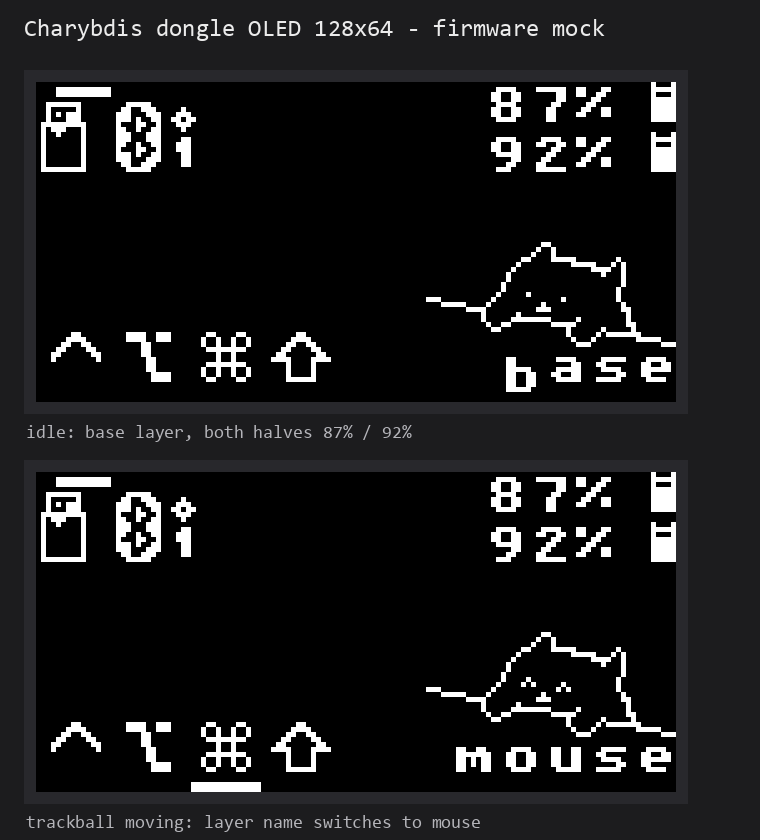

# zmk-config-dragonball

_(keymap image generated by [caksoylar/keymap-drawer](https://github.com/caksoylar/keymap-drawer))_

## Dongle display preview

The 128x64 OLED is driven by [`englmaxi/zmk-dongle-display`](https://github.com/englmaxi/zmk-dongle-display).
The image below is a mock rendered from the firmware's own 1-bit bitmaps and LVGL
`unscii_8` font (not a photo):

## wqliu branch notes

Trackball tuning, the movement-gated mouse layer (400 ms timeout + non-trans key
extension) and display notes are documented in [README-wqliu.md](README-wqliu.md).

